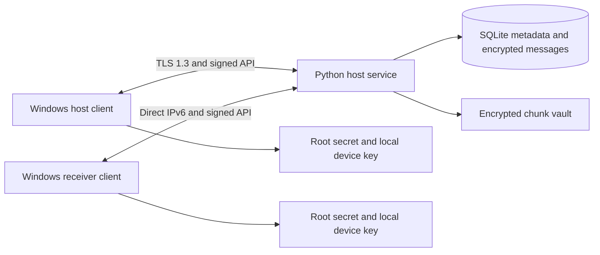

# R14 architecture

## Connection

The PV2 invitation contains an address, port and host public-key fingerprint. On enrollment the client verifies the pinned certificate, performs a password-authenticated challenge, proves root-key possession via a derived Ed25519 signing key and signs using its separate persistent device identity. The server binds the name to its device public key and issues a session token. Subsequent requests carry Ed25519 signatures over the method, route, body digest, nonce and timestamp, with range and content-type headers included. The client validates sender signatures before releasing message ciphertext to the UI.

## Epoch synchronization

Both clients derive the same epoch-specific AES-256 keys from the shared root using HKDF-SHA256. Signed rotation events are stored by the host and verified by clients. Local trust state pins known peer identities and rotation history. Files identify their encryption epoch in their IDs and use separate file keys derived with HKDF-SHA512. Previous epoch keys can be reconstructed from the root, so this design is not forward-secret.

## Files

The receiver requests upload permission, the host approves, and encrypted 4 MiB chunks are stored on the host. Downloads preserve source bytes. Small downloads can be decrypted on the client; larger downloads and certain media previews may explicitly provide a file-specific key to the host for temporary assisted processing. The video fallback uses CUDA/NVENC H.264 conversion where supported; it is a compatibility preview, not a lossless replacement.

## Storage

Production profile: `%LOCALAPPDATA%\PhantomVaultDesktop_R14`. The profile is separate from R13. The app can archive an existing room without deleting its data. The portable build is separate from the profile. Neither is committed to this repository.
